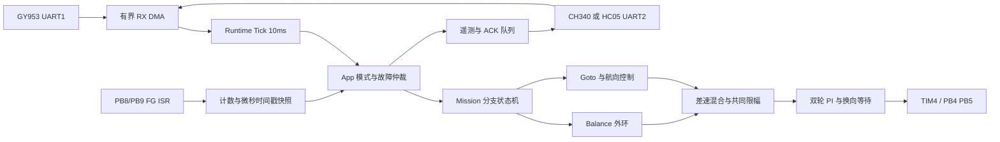

# 实现架构

所有生产业务算法在App，host测试直接编译这些源文件。BSP寄存器代码独立，runtime可用fake Board接口执行；厂商层只读。Core USER CODE创建唯一CourseTask、故障钩子，原模板任务立即终止。

MODE0诊断无输出；MODE1有符号RPM手动；MODE2有符号占空比手动；MODE3本地自主。默认解除ARM，标定为0。运行中禁止修改参数和手动抢占AUTO，STOP可从任何模式归零；故障锁存后需解除ARM清故障，CLEAR不会重置硬件或消除故障原因。

任务分支：

| profile | 状态链 |
|---|---|
| 1 A | BALANCE：Pitch正前进/负后退/近零停，稳定1s→DONE；本轮用户目标，Yaw不参与 |
| 2 ENTRY | ALIGN→APPROACH→CLIMB→SEEK→DONE |
| 3 BALANCE_RETURN | 同入口→SEEK→BALANCE连续10s→RETURN→ARRIVED |
| 4 WEIGHT_RETURN | 同3，配重由实物施加，不由软件假定质量 |
| 5 REWEIGHT | 同入口→SEEK→BALANCE→HOLD；扰动→BALANCE→HOLD |
| 6 PRELIM | 同入口→SEEK→RETURN，找倾覆起5s限时 |
| 7 RECTANGLE | 4段CW→DOCK→4段CCW→DOCK→DONE |

板上阶段有当前姿态包络、最大倾角、IMU年龄、方向/里程一致性、任务时限与电机反馈限制。包络下限保留A入口通道，因此不是完整边缘传感或制动模型；详见limitations。无独立传感器时未知坡面回滚和轮胎打滑不一定触发故障。

LED：平衡达成与完成/到达常亮；RETURN每250ms翻转；故障每150ms翻转；其余关闭。LED由runtime唯一控制，不与旧模板任务争用。主循环不printf，无ISR浮点控制，无动态逐帧分配。

`MissionInput`测试直接提供姿态与位姿以验证状态/时限；这不是物理模型仿真。PC演示是生成曲线，也不是动力学仿真。两者都不构成实物任务得分。
